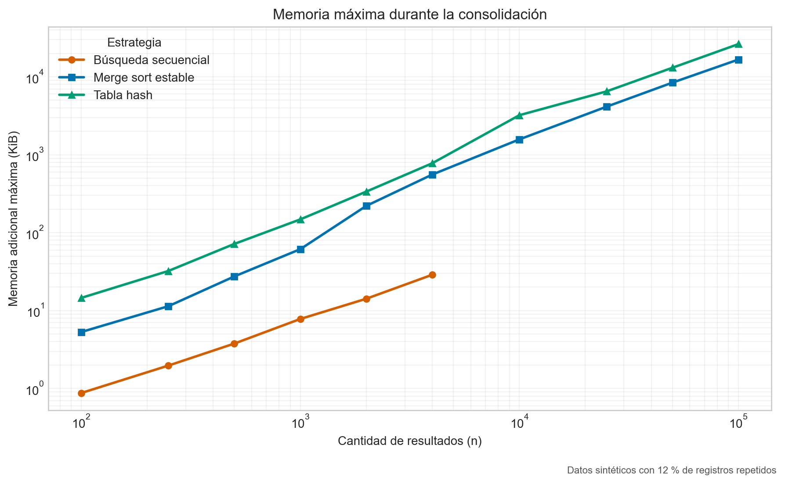
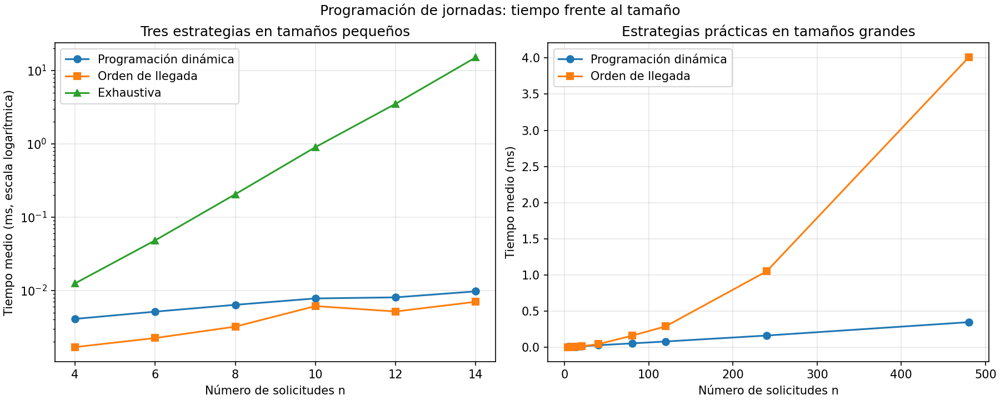
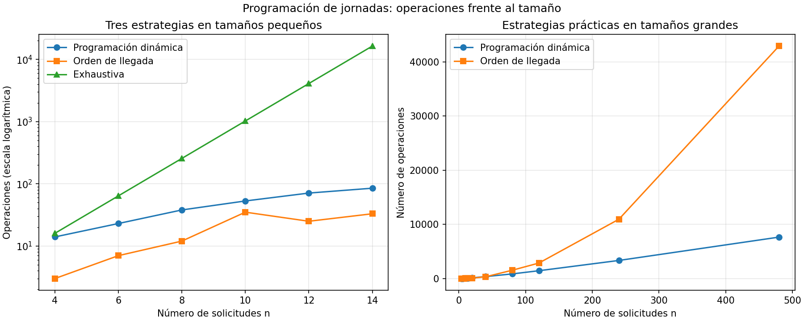

# Proyecto final — Análisis de algoritmos

**Caso 2: Plataforma Pulso**

**Integrantes:** Carla Giraldo, Sara Regino, Alejandra Madrid y Laura Posada.

## Análisis del problema

### Contexto y proceso completo de Plataforma Pulso

Plataforma Pulso apoya el tamizaje de diabetes y recibe diariamente resultados
de 290 laboratorios e instituciones prestadoras de salud. Cada resultado
contiene el tipo y número de documento del paciente, el laboratorio y lote de
origen, la fecha del resultado, un índice de riesgo entre 0 y 100 y el
municipio. Como estos datos identifican personas y describen su estado de
salud, su integridad y confidencialidad son requisitos del proceso, no solo
características técnicas.

El flujo operativo estudiado comprende cuatro operaciones relacionadas:

1. **Consolidación de pacientes repetidos.** De los 1 450 000 resultados
   pendientes de un día típico, entre el 8 % y el 15 % corresponde a personas
   que ya aparecen en la plataforma. Para cada paciente debe conservarse
   únicamente el resultado más reciente, sin modificar los registros
   originales ni hacer desaparecer pacientes. El procedimiento actual compara
   cada resultado nuevo con la lista consolidada hasta encontrar su documento.
2. **Lista diaria de llamadas.** A partir de los resultados consolidados se
   deben seleccionar exactamente los 9 000 pacientes con mayor índice de
   riesgo. Cuando dos pacientes tienen el mismo índice, se atiende primero el
   resultado más antiguo. El proceso actual mantiene la lista mediante
   ordenamiento por inserción.
3. **Programación de unidades móviles.** Cada una de las nueve subregiones
   dispone de una unidad y recibe entre 40 y 120 solicitudes mensuales. Debe
   elegirse un conjunto de jornadas sin cruces. En este proyecto se maximiza la
   cantidad de pacientes de alto riesgo atendidos; esta es la operación
   desarrollada en el Laboratorio 4.
4. **Vigilancia de calidad de laboratorios.** Para cada laboratorio se busca el
   intervalo consecutivo de lotes con el mayor exceso acumulado de resultados
   positivos. Se procesan cerca de 30 lotes diarios por laboratorio y tres años
   de historia equivalen aproximadamente a 33 000 lotes por laboratorio. El
   procedimiento actual examina todos los subarreglos y puede tardar varios
   días.

Las operaciones de consolidación y lista de llamadas se ejecutan dentro de una
ventana nocturna de cuatro horas, entre la 01:00 y las 05:00. En conjunto, el
proceso actual tarda cerca de siete horas, por lo que no cumple esa ventana.
Este tiempo es una referencia combinada de ambas operaciones y no se atribuye
por completo a ninguna de ellas por separado.

El servidor disponible consume 380 W, ejecuta un solo hilo y no permite
distribuir el procesamiento. Además de la restricción temporal, el resultado
debe respetar las reglas funcionales: un registro vigente por paciente, una
lista de exactamente 9 000 llamadas, jornadas sin solapamientos y un intervalo
de vigilancia exactamente óptimo. Los registros originales de los
laboratorios deben permanecer sin alteraciones para conservar su trazabilidad.

### Alcance del proyecto

El proyecto implementará y comparará dos de las cuatro operaciones. La primera
es la programación de las jornadas de unidades móviles, ya terminada como parte
del Laboratorio 4 mediante intervalos ponderados. La segunda será la
consolidación de pacientes repetidos, para la cual se estudiarán diferentes
estructuras y estrategias antes de recomendar una solución.

Para ambas operaciones se presentarán al menos dos alternativas, análisis de
complejidad temporal y espacial, pruebas de corrección, mediciones con datos
sintéticos reproducibles y una estimación de energía. El análisis distinguirá
los resultados medidos de las extrapolaciones al volumen real y explicará sus
supuestos y limitaciones. También se examinarán las consecuencias de una
decisión incorrecta sobre la oportunidad de atención, la privacidad y la
equidad.

Las operaciones de selección de llamadas y vigilancia de laboratorios se
describen para comprender el proceso completo, pero no se implementarán. La
solución tampoco se integrará con sistemas clínicos reales ni utilizará datos
personales verdaderos. Por tratarse de un ejercicio académico, los datos serán
sintéticos y las recomendaciones constituirán un análisis algorítmico, no una
decisión clínica ni una validación jurídica del sistema.

### Modelo de la consolidación de pacientes

La segunda operación recibe una secuencia de resultados en el mismo orden en
que llegaron a la plataforma. Cada resultado se representará mediante un
registro inmutable con estos campos:

| Campo | Tipo en Python | Significado |
|---|---|---|
| `tipo_documento` | `str` | Tipo de identificación del paciente |
| `numero_documento` | `str` | Número de identificación del paciente |
| `id_laboratorio` | `str` | Laboratorio o IPS que produjo el resultado |
| `id_lote` | `str` | Lote de procesamiento del laboratorio |
| `fecha_resultado` | `datetime` | Fecha y hora del resultado |
| `indice_riesgo` | `int` | Índice de riesgo entre 0 y 100 |
| `municipio` | `str` | Municipio asociado al resultado |

La identidad de un paciente es la tupla
`(tipo_documento, numero_documento)`. No se usará solamente el número porque
dos documentos de distinto tipo podrían compartir la misma representación
textual. Los demás campos pertenecen al resultado clínico y no forman parte de
la clave.

La salida será una lista nueva con exactamente un resultado por clave de
paciente. Para facilitar la comparación reproducible entre estrategias, las
claves se presentarán en el orden de su primera aparición en la entrada. Los
registros de entrada son inmutables y ninguna estrategia puede alterar la
secuencia original.

#### Reglas de selección y desempate

Para cada paciente se conservará el registro cuya `fecha_resultado` sea más
reciente. Un registro reemplaza al guardado únicamente cuando su fecha es
estrictamente posterior. Si dos registros del mismo paciente tienen la misma
fecha y hora, se conserva el primero recibido en la secuencia de entrada. Esta
regla determinista evita que las estrategias escojan resultados diferentes en
un empate no especificado por el caso.

Una salida se considera correcta si cumple simultáneamente estas propiedades:

- contiene todas las claves de pacientes presentes en la entrada y ninguna
  adicional;
- contiene una sola vez cada clave;
- para cada clave conserva el resultado de fecha máxima;
- en un empate de fecha conserva el primero recibido;
- no modifica los registros ni el orden de la entrada;
- presenta la salida en el orden determinista definido.

La entrada vacía produce una lista vacía. Un paciente con un solo resultado se
conserva sin cambios. Los datos sintéticos usarán fechas comparables y un
índice de riesgo dentro del intervalo permitido, pero las estrategias no
supondrán que los resultados de un paciente llegan ordenados por fecha.

#### Estrategias que se compararán

1. **Búsqueda secuencial en una lista.** Representa el procedimiento actual:
   para cada resultado se recorre la lista consolidada hasta hallar la misma
   clave o llegar al final. Su peor caso es cuadrático y servirá como línea
   base.
2. **Ordenamiento estable.** Se agrupan los registros al ordenarlos por la
   clave del paciente y se elige el más reciente de cada grupo. La estabilidad
   preserva el primer registro recibido cuando las fechas empatan. Se espera
   un tiempo `Θ(n log n)`.
3. **Tabla hash con encadenamiento.** La clave del paciente se ubica en una
   cubeta y las colisiones se resuelven comparando la clave completa dentro de
   la lista de esa cubeta. Se controlará el factor de carga mediante
   redimensionamiento. Su tiempo esperado es lineal con un factor de carga
   acotado, aunque su peor caso sigue siendo cuadrático si todas las claves
   colisionan.

Las tres estrategias aplicarán las mismas reglas, recibirán las mismas entradas
y producirán los pacientes en el mismo orden de primera aparición. Las
mediciones incluirán todo el trabajo necesario para obtener esa salida, pero no
la generación previa de los datos de entrada.

### Diseño y complejidad de la consolidación

Para el análisis se usa `n` como la cantidad de resultados recibidos, `u` como
la cantidad de pacientes distintos, `m` como el número de cubetas de la tabla
hash y `α = u/m` como su factor de carga. La longitud de los documentos se
considera acotada por el formato del sistema; si se tratara como variable,
calcular y comparar claves añadiría un factor proporcional a esa longitud.

#### Estructuras de datos

| Elemento | Estructura | Motivo |
|---|---|---|
| Resultado | Clase de datos inmutable | Evita alterar los registros originales |
| Clave de paciente | Tupla `(tipo, número)` | Distingue documentos de diferente tipo |
| Estrategia secuencial | Lista de resultados | Representa el procedimiento actual |
| Estrategia de ordenamiento | Listas de pares `(posición, resultado)` | Conserva la primera aparición durante la agrupación |
| Estrategia hash | Arreglo de cubetas con listas | Permite resolver colisiones por encadenamiento |
| Orden de la tabla hash | Lista de claves | Produce la salida sin ordenar nuevamente |

La tabla hash implementada no depende de `dict`. Aplica una mezcla FNV-1a
determinista a los dos componentes de la clave y obtiene la cubeta mediante el
residuo con una capacidad prima. Cada búsqueda compara la clave completa, no
solo su valor hash. Antes de insertar un paciente nuevo, la tabla se amplía
cuando el factor de carga superaría `0,75`; la nueva capacidad es el primer
primo mayor o igual al doble de la anterior y todas las entradas se reubican.

#### Pseudocódigo de la búsqueda secuencial

```text
CONSOLIDAR-SECUENCIAL(resultados)
    consolidados ← lista vacía
    para cada resultado en resultados
        buscar su clave de izquierda a derecha en consolidados
        si la clave no existe
            agregar resultado al final
        si la clave existe y resultado.fecha > guardado.fecha
            reemplazar el guardado en la misma posición
    retornar consolidados
```

Con `u` pacientes ya consolidados, una inserción puede efectuar `u`
comparaciones. Si todas las claves son distintas, el total es
`0 + 1 + ... + (n - 1)`, por lo que el peor caso es `Θ(n²)`. Si todos los
resultados pertenecen al mismo paciente, la clave se encuentra en la primera
posición y el tiempo es `Θ(n)`. El espacio adicional de la salida es `Θ(u)`.

#### Pseudocódigo del ordenamiento estable

```text
CONSOLIDAR-ORDENAMIENTO(resultados)
    numerados ← pares (posición original, resultado)
    agrupados ← MERGE-SORT-ESTABLE(numerados, clave del paciente)
    seleccionados ← lista vacía
    para cada grupo de una misma clave en agrupados
        elegido ← primer resultado del grupo
        para cada candidato restante del grupo
            si candidato.fecha > elegido.fecha
                elegido ← candidato
        guardar (posición de la primera aparición, elegido)
    ordenar seleccionados por posición con MERGE-SORT-ESTABLE
    retornar los resultados sin las posiciones
```

El primer merge sort cuesta `Θ(n log n)`, recorrer los grupos cuesta `Θ(n)` y
el segundo ordenamiento cuesta `Θ(u log u)`. Como `u ≤ n`, el tiempo total es
`Θ(n log n)` y el espacio adicional máximo es `Θ(n)`. Dar prioridad a la mitad
izquierda durante la mezcla hace estable el ordenamiento; por eso, al reemplazar
solo ante una fecha estrictamente posterior, se conserva el primer registro en
los empates.

#### Pseudocódigo de la tabla hash

```text
CONSOLIDAR-HASH(resultados)
    tabla ← arreglo de cubetas vacías
    orden_claves ← lista vacía
    para cada resultado en resultados
        índice ← HASH(resultado.clave) módulo cantidad de cubetas
        buscar la clave completa dentro de esa cubeta
        si la clave existe y resultado.fecha > guardado.fecha
            reemplazar el resultado de esa entrada
        si la clave no existe
            redimensionar y reubicar entradas si se superaría α = 0,75
            agregar (clave, resultado) a su cubeta
            agregar clave a orden_claves
    retornar el resultado asociado con cada clave de orden_claves
```

Con dispersión uniforme, buscar o insertar cuesta `Θ(1 + α)` en promedio. Al
mantener `α` acotado, procesar y recuperar los resultados cuesta `Θ(n)`
esperado. Cada redimensionamiento cuesta `Θ(u)`, pero las capacidades crecen
aproximadamente al doble, de modo que ese trabajo es amortizado. En el peor
caso todas las claves caen en una misma cubeta y el tiempo se degrada a
`Θ(n²)`. El espacio es `Θ(m + u)` y, como el redimensionamiento mantiene
`m = Θ(u)`, se simplifica a `Θ(u)`.

#### Comparación teórica

| Estrategia | Mejor caso | Caso esperado o general | Peor caso | Espacio adicional |
|---|---:|---:|---:|---:|
| Búsqueda secuencial | `Θ(n)` | Depende de pacientes y orden | `Θ(n²)` | `Θ(u)` |
| Merge sort estable | `Θ(n log n)` | `Θ(n log n)` | `Θ(n log n)` | `Θ(n)` |
| Tabla hash | `Θ(n)` | `Θ(n)` con `α` acotado | `Θ(n²)` | `Θ(u)` |

La tabla hash es la candidata teórica para el volumen diario porque evita
ordenar y mantiene acceso esperado constante. Esta conclusión deberá
contrastarse con tiempo, operaciones y memoria medidos antes de formular la
recomendación definitiva.

### Evaluación experimental de la consolidación

Las tres estrategias recibieron exactamente las mismas entradas para cada
tamaño, generadas con una semilla fija y un 12 % de registros repetidos. Los
datos se crearon antes de iniciar el cronómetro. Cada tiempo es el promedio de
cinco ejecuciones con `time.perf_counter()` después de una ejecución de
calentamiento. La memoria adicional máxima se midió por separado con
`tracemalloc`; no incluye la entrada ya creada, el intérprete ni las
bibliotecas cargadas.

El contador registra comparaciones de claves, fechas y posiciones. Esta unidad
común permite estudiar el crecimiento con menos dependencia del computador,
aunque no representa todas las instrucciones ejecutadas: el tiempo sí incluye
el cálculo del hash, las asignaciones y los redimensionamientos. La estrategia
secuencial se midió hasta 4 000 resultados por su rápido crecimiento; merge
sort y hash se ampliaron hasta 100 000.




Algunos resultados representativos son:

| `n` | Estrategia | Tiempo promedio | Comparaciones | Memoria adicional máxima |
|---:|---|---:|---:|---:|
| 100 | Secuencial | 1,162 ms | 4 142 | 0,875 KiB |
| 100 | Merge sort | 0,577 ms | 1 118 | 5,305 KiB |
| 100 | Hash | 0,716 ms | 185 | 14,543 KiB |
| 4 000 | Secuencial | 1 781,823 ms | 6 754 891 | 28,805 KiB |
| 4 000 | Merge sort | 34,894 ms | 84 377 | 556,207 KiB |
| 4 000 | Hash | 26,807 ms | 7 621 | 776,871 KiB |
| 100 000 | Merge sort | 1 398,248 ms | 2 985 107 | 16 667,066 KiB |
| 100 000 | Hash | 985,473 ms | 184 250 | 26 309,043 KiB |

La búsqueda secuencial usa menos memoria porque su salida contiene referencias
a los registros sin estructuras auxiliares grandes, pero esa ventaja no
compensa su tiempo cuadrático. La tabla hash usa más memoria que merge sort en
estas mediciones debido al arreglo de cubetas, las listas de colisiones y la
lista que conserva el orden de primera aparición.

#### Factores de crecimiento observados

Para la búsqueda secuencial se compararon `n = 2 000` y `n = 4 000`. Al
duplicar la entrada, el tiempo se multiplicó por 4,05 y las comparaciones por
3,98, valores cercanos al factor 4 esperado para `Θ(n²)`. La memoria se
multiplicó por 2,03, coherente con almacenar una salida lineal.

Para las estrategias eficientes se compararon 50 000 y 100 000 resultados:

| Estrategia | Factor de tiempo | Factor de comparaciones | Factor de memoria | Referencia teórica |
|---|---:|---:|---:|---:|
| Merge sort | 2,23 | 2,14 | 1,98 | 2,13 para `n log n` |
| Hash | 2,25 | 2,01 | 2,01 | 2 para crecimiento lineal esperado |

Las comparaciones y la memoria siguen muy de cerca la teoría. Los factores de
tiempo son un poco mayores por el costo del intérprete, la gestión de memoria,
la caché y los procesos activos. Por eso la evidencia no se basa únicamente en
tiempos de pared.

#### Extrapolación al volumen diario

El volumen objetivo es `N = 1 450 000` resultados. La búsqueda secuencial se
proyectó desde 4 000 mediante `(N/4 000)²`; merge sort se proyectó desde
100 000 mediante `(N log N)/(100 000 log 100 000)`; y la tabla hash mediante
`N/100 000`. Para la memoria se aplicó crecimiento lineal a las tres.

| Estrategia | Factor aplicado al tiempo | Tiempo estimado | Comparaciones estimadas | Memoria adicional estimada |
|---|---:|---:|---:|---:|
| Secuencial | 131 406,25 | 65,04 horas | `8,88·10^11` | 10,20 MiB |
| Merge sort | 17,87 | 24,98 segundos | `5,33·10^7` | 236,01 MiB |
| Hash | 14,50 | 14,29 segundos | `2,67·10^6` | 372,54 MiB |

La estimación secuencial excede ampliamente la ventana nocturna de cuatro
horas. Merge sort y hash quedarían muy por debajo de ella para esta operación
aislada, y hash presenta el menor tiempo y número de comparaciones estimados.
Sin embargo, esto no demuestra todavía que el proceso completo cumpla la
ventana: las cuatro horas corresponden al conjunto de consolidación y lista de
llamadas, mientras que las siete horas actuales también son una cifra
combinada.

Estas proyecciones no son ejecuciones de 1 450 000 registros ni mediciones del
servidor de 380 W. Suponen que se mantiene el 12 % de repetidos, que no cambia
la distribución de las claves y que continúa la tendencia observada. El sistema
operativo, la versión de Python, la longitud real de los documentos, las
colisiones y otros procesos pueden modificar los tiempos y la memoria. Por
ello, los valores sirven para comparar órdenes de magnitud y deben validarse en
el servidor antes de una puesta en producción.

#### Consumo energético de la consolidación

El enunciado asigna al servidor una potencia de 380 W, equivalentes a
`0,38 kW`. Para cada estrategia se estima la energía de una ejecución mediante
`E = P·t`, con el tiempo extrapolado convertido a horas. La proyección anual
supone una consolidación cada noche durante 365 días:

```text
Ejecución: E = 0,38 kW × tiempo en horas
Año:      E_anual = E × 365
```

| Estrategia | Tiempo extrapolado por noche | Energía por noche | Energía anual |
|---|---:|---:|---:|
| Secuencial | 65,04 h | 24,7151 kWh | 9 020,9971 kWh |
| Merge sort | 24,98 s | 0,002637 kWh | 0,9626 kWh |
| Hash | 14,29 s | 0,001508 kWh | 0,5505 kWh |

La proyección secuencial es un escenario teórico: no podría terminar dentro de
la ventana nocturna ni repetirse diariamente en esas condiciones. Sirve para
mostrar que el crecimiento cuadrático no solo retrasa la atención, sino que
mantendría ocupado el servidor durante mucho más tiempo. Entre las alternativas
viables, hash requiere aproximadamente un 42,8 % menos energía que merge sort
para esta operación, pero la diferencia absoluta estimada es de apenas
0,4120 kWh al año. La decisión no debe justificarse con un ahorro ambiental
exagerado; sus ventajas principales son tiempo y escalabilidad.

Como referencia del proceso actual completo, las operaciones de consolidación
y lista de llamadas tardan juntas cerca de siete horas. Si se atribuyen los
380 W constantes a todo ese intervalo, la línea base combinada es:

```text
0,38 kW × 7 h = 2,66 kWh por noche
2,66 kWh × 365 = 970,90 kWh por año
```

No es válido comparar esa cifra directamente con los 0,5505 kWh anuales de la
tabla hash como si toda la diferencia fuera un ahorro. El enunciado no indica
cuántas de las siete horas corresponden a consolidar y cuántas a construir la
lista de llamadas. Para estimar el nuevo consumo total sería necesario medir
ambas operaciones por separado en el servidor.

La estimación supone que el servidor demanda 380 W constantes y que toda esa
potencia se atribuye al algoritmo. No incluye consumo en reposo, refrigeración,
almacenamiento ni comunicaciones. Además, combina tiempos extrapolados desde
el computador de prueba con la potencia nominal del servidor; por tanto, es
una proyección académica y no una medición eléctrica de producción.

#### Comparación y recomendación para la consolidación

Las tres estrategias producen la misma salida correcta, pero presentan
compromisos distintos en el volumen típico de 1 450 000 resultados:

| Criterio | Secuencial | Merge sort estable | Tabla hash |
|---|---|---|---|
| Tiempo estimado | 65,04 h | 24,98 s | 14,29 s |
| Comparaciones estimadas | `8,88·10^11` | `5,33·10^7` | `2,67·10^6` |
| Memoria adicional estimada | 10,20 MiB | 236,01 MiB | 372,54 MiB |
| Complejidad esperada | Depende del orden, hasta `Θ(n²)` | `Θ(n log n)` | `Θ(n)` |
| Peor caso | `Θ(n²)` | `Θ(n log n)` | `Θ(n²)` por colisiones extremas |

Se recomienda la tabla hash con encadenamiento. Presenta el menor tiempo y
número de comparaciones, mantiene el orden de primera aparición y permite
conservar el resultado más reciente sin ordenar toda la entrada. Su memoria es
mayor y su garantía de tiempo es esperada, por lo que antes de producción deben
verificarse la memoria disponible, el factor de carga y la distribución de
colisiones en el servidor.

Merge sort es una alternativa de respaldo apropiada si se necesita un peor
caso `Θ(n log n)` o si la memoria medida de la tabla no cabe en el entorno. La
búsqueda secuencial debe mantenerse solamente como referencia del procedimiento
actual y para entradas muy pequeñas; su proyección no satisface la ventana.

La recomendación técnica no elimina los controles funcionales. La ejecución
debe conciliar el número de pacientes distintos, comprobar que ninguna clave
desaparezca, conservar los originales y registrar redimensionamientos o tasas
de colisión anómalas.

#### Escenario de crecimiento: tamizaje de hipertensión

Si la plataforma incorpora tamizaje de hipertensión, el enunciado plantea que
los resultados diarios se duplican hasta `2 900 000`. Aplicando las mismas
tendencias y manteniendo el 12 % de repetidos se obtiene:

| Estrategia | Tiempo estimado | Comparaciones estimadas | Memoria adicional estimada |
|---|---:|---:|---:|
| Secuencial | 260,16 h (10,84 días) | `3,55·10^12` | 20,39 MiB |
| Merge sort | 52,41 s | `1,12·10^8` | 472,02 MiB |
| Hash | 28,58 s | `5,34·10^6` | 745,08 MiB |

Duplicar la entrada multiplica aproximadamente por cuatro el trabajo
cuadrático, por 2,10 el trabajo `n log n` y por dos el trabajo esperado lineal.
La tabla hash seguiría siendo la alternativa más rápida bajo los supuestos del
experimento y su energía anual estimada para esta operación sería cerca de
1,10 kWh. El uso de unos 745 MiB adicionales debe comprobarse en el servidor;
si no es viable, merge sort conserva un tiempo estimado menor a un minuto con
menos memoria.

El aumento no es únicamente cuantitativo. El modelo actual identifica el último
resultado de diabetes por paciente. Si llegan resultados de dos programas, la
clave debe incorporar el tipo de tamizaje, por ejemplo
`(tipo_documento, numero_documento, tipo_tamizaje)`, o mantener historiales
separados. De lo contrario, un resultado reciente de hipertensión podría
reemplazar indebidamente el de diabetes. El esquema, el generador y las pruebas
deberían ampliarse antes de activar el nuevo programa.

También se debe definir si los índices de riesgo de ambas enfermedades son
comparables y cómo se distribuyen las 9 000 llamadas diarias. Mantener la misma
capacidad con el doble de resultados aumenta la competencia por atención y
puede afectar de manera distinta a municipios o grupos de pacientes. Esa regla
requiere una decisión clínica y de política pública, seguimiento de equidad y
capacidad de revisión humana; no debe resolverse sumando o comparando índices
sin validación.

### Programación de las jornadas de las unidades móviles

Plataforma Pulso recibe mensualmente entre 40 y 120 solicitudes de jornada en
cada una de las nueve subregiones. Cada subregión dispone de una sola unidad
móvil. Una solicitud contiene la hora de inicio, la hora de finalización —que
ya incluye el desplazamiento— y el número de pacientes de alto riesgo
pendientes en el municipio.

La entrada de la operación es una lista de jornadas representadas por tuplas
`(inicio, fin, pacientes_alto_riesgo)`, con las horas expresadas en minutos. La
salida es un subconjunto de esas jornadas, ordenado por hora de inicio, cuya
suma de pacientes sea la mayor posible.

La solución debe cumplir las siguientes restricciones:

- una unidad móvil no puede estar asignada a dos jornadas que se crucen;
- dos jornadas que se tocan en un extremo son compatibles, pues se usa el
  intervalo `[inicio, fin)` y el desplazamiento ya está incluido en el fin;
- las solicitudes originales no se modifican;
- el resultado debe ser óptimo, no una aproximación;
- si existen varias programaciones con el mismo valor, cualquiera de ellas es
  válida siempre que cumpla las restricciones.

El criterio elegido es maximizar los pacientes de alto riesgo atendidos. No se
maximiza solamente la cantidad de jornadas, porque una jornada puede atender a
muchos más pacientes que otra.

### Supuestos de esta operación

- Cada subregión se procesa por separado porque dispone de una unidad móvil.
- La programación se calcula una vez al mes para cada una de las nueve
  subregiones.
- Dos jornadas que se tocan son compatibles: los intervalos son `[inicio, fin)`.
- El servidor consume 380 W durante la ejecución; se usa esa potencia constante
  como estimación conservadora.
- Los datos sintéticos conservan la estructura del caso, pero no representan
  una predicción de la demanda ni de los pacientes reales.

## Diseño de la solución

### Por qué el problema admite programación dinámica

Primero se ordenan las solicitudes por su hora de finalización. Para cada
jornada `j` se calcula `p(j)`: la cantidad de jornadas anteriores que terminan
antes o exactamente cuando empieza `j`. De esta manera, las jornadas
compatibles anteriores forman un prefijo de la lista ordenada.

Se define `M[j]` como el máximo número de pacientes que se puede atender usando
únicamente las primeras `j` jornadas. Para decidir sobre la jornada `j` se
comparan dos opciones:

1. No elegirla, por lo que se conserva `M[j - 1]`.
2. Elegirla, sumar sus pacientes `v[j]` y continuar con el mejor resultado del
   prefijo compatible `M[p(j)]`.

La recurrencia es:

```text
M[0] = 0
M[j] = max(M[j - 1], v[j] + M[p(j)])
```

El problema tiene **subestructura óptima**: si una solución óptima incluye la
jornada `j`, las jornadas anteriores seleccionadas deben formar una solución
óptima para el prefijo `p(j)`. Si no fuera así, se podría sustituir ese prefijo
por uno mejor y aumentar el total de pacientes, contradiciendo la optimalidad.

También existen **subproblemas traslapados**. Valores como `M[2]` o `M[3]`
pueden ser necesarios al evaluar distintas jornadas posteriores. La tabla
guarda cada resultado una sola vez y se llena de izquierda a derecha, ya que
`M[j]` depende únicamente de posiciones menores que `j`.

Ordenar y calcular `p(j)` mediante búsqueda binaria cuesta `Θ(n log n)`. Llenar
la tabla y reconstruir una solución cuesta `Θ(n)`. Por tanto, la complejidad
temporal total es `Θ(n log n)` y el espacio adicional es `Θ(n)`.

### Ejemplo resuelto a mano

Considérese una subregión con las siguientes seis solicitudes:

| Jornada | Horario | Pacientes |
|---|---|---:|
| A | 08:00–10:00 | 20 |
| B | 09:00–12:00 | 55 |
| C | 10:00–11:00 | 15 |
| D | 11:00–13:00 | 25 |
| E | 12:00–15:00 | 50 |
| F | 14:00–16:00 | 30 |

Al ordenar por hora de finalización se obtiene `A, C, B, D, E, F`. Los valores
de compatibilidad y de la tabla dinámica son:

| `j` | Jornada | `p(j)` | No elegir: `M[j-1]` | Elegir: `v[j] + M[p(j)]` | `M[j]` |
|---:|---|---:|---:|---:|---:|
| 0 | — | — | — | — | 0 |
| 1 | A | 0 | 0 | 20 + 0 = 20 | 20 |
| 2 | C | 1 | 20 | 15 + 20 = 35 | 35 |
| 3 | B | 0 | 35 | 55 + 0 = 55 | 55 |
| 4 | D | 2 | 55 | 25 + 35 = 60 | 60 |
| 5 | E | 3 | 60 | 50 + 55 = 105 | 105 |
| 6 | F | 4 | 105 | 30 + 60 = 90 | 105 |

La respuesta es `M[6] = 105`. Para reconstruirla se comienza en la última
posición. F no se elige porque 90 no supera 105. E sí se elige y se salta a
`p(5) = 3`. En esa posición se elige B y se llega al caso base. La programación
óptima es, por tanto, B de 09:00 a 12:00 y E de 12:00 a 15:00, que atienden
`55 + 50 = 105` pacientes sin cruces.

## Implementación

### Jornadas de unidades móviles

La primera operación se separó en módulos con responsabilidades específicas:

- [`estrategia.py`](src/jornadas_unidades/estrategia.py): ordenamiento,
  compatibilidades, tabla dinámica y reconstrucción de las jornadas.
- [`exhaustivo.py`](src/jornadas_unidades/exhaustivo.py): referencia exacta que
  enumera todos los subconjuntos para entradas pequeñas.
- [`regla_actual.py`](src/jornadas_unidades/regla_actual.py): asignación en el
  orden de llegada usada como línea base.
- [`datos.py`](src/jornadas_unidades/datos.py): solicitudes sintéticas con
  semilla fija.
- [`pruebas.py`](src/jornadas_unidades/pruebas.py): casos límite, ejemplo manual,
  contraejemplo y 50 instancias aleatorias.
- [`medicion.py`](src/jornadas_unidades/medicion.py): cronometraje, conteo de
  operaciones y generación de gráficas.

Las funciones trabajan con copias o listas nuevas para conservar las
solicitudes originales. La solución exhaustiva ordena una vez las solicitudes
y después recorre sus `2^n` subconjuntos; se usa como oráculo, no como propuesta
para producción.

### Consolidación de pacientes

La segunda operación se organiza así:

- [`modelo.py`](src/consolidacion_pacientes/modelo.py): registro inmutable y
  clave compuesta del paciente.
- [`secuencial.py`](src/consolidacion_pacientes/secuencial.py): procedimiento
  actual basado en búsqueda lineal.
- [`ordenamiento.py`](src/consolidacion_pacientes/ordenamiento.py): merge sort
  estable, agrupación y recuperación del orden de primera aparición.
- [`tabla_hash.py`](src/consolidacion_pacientes/tabla_hash.py): tabla propia con
  encadenamiento, factor de carga y redimensionamiento.
- [`datos.py`](src/consolidacion_pacientes/datos.py): resultados sintéticos con
  proporción de duplicados y semilla configurables.
- [`pruebas.py`](src/consolidacion_pacientes/pruebas.py): casos controlados,
  colisiones, redimensionamiento y 100 instancias aleatorias contra un oráculo.
- [`medicion.py`](src/consolidacion_pacientes/medicion.py): tiempos,
  comparaciones, memoria y exportación a CSV.
- [`graficar.py`](src/consolidacion_pacientes/graficar.py): figuras reproducibles
  a partir del archivo de resultados.

Las tres estrategias respetan la misma interfaz y no modifican la entrada. El
resultado CSV queda en [`resultados/consolidacion.csv`](resultados/consolidacion.csv)
y permite regenerar las gráficas sin repetir las mediciones.

## Evaluación del desempeño

### Complejidad y verificación

La programación dinámica tarda `Θ(n log n)`: el ordenamiento y las `n`
búsquedas binarias dominan el llenado y la reconstrucción lineales. Usa
`Θ(n)` de espacio para las listas ordenadas, las compatibilidades, la tabla y
la solución reconstruida.

La solución exhaustiva considera `2^n` subconjuntos y dedica hasta `Θ(n)` a
construir y revisar cada uno. Su tiempo es `Θ(n·2^n)` y su espacio auxiliar es
`Θ(n)`. La regla actual puede comparar cada nueva solicitud con todas las ya
aceptadas: tarda `O(n²)` en el peor caso y usa `O(n)` de espacio.

Para respaldar el análisis espacial se midió con `tracemalloc` la memoria
adicional máxima de la programación dinámica, después de generar la entrada y
de una ejecución inicial de calentamiento. Con 120 solicitudes el pico fue de
aproximadamente **5,6 KiB** y con 480 fue de **29,7 KiB**. Al multiplicar `n`
por cuatro, la memoria creció cerca de 5,3 veces, una variación compatible con
el crecimiento lineal y con la administración interna de memoria de Python.
La medición no incluye la lista de entrada, el intérprete ni sus bibliotecas;
representa solamente las asignaciones adicionales durante el algoritmo.

Las pruebas cubren la entrada vacía, una jornada, ninguna y todas las jornadas
cruzadas, jornadas que se tocan, el ejemplo manual y el contraejemplo de la
regla actual. También comparan el valor de la solución dinámica con el de la
exhaustiva en 50 instancias aleatorias pequeñas y verifican que no haya cruces.

### Metodología de medición

La comparación usa las mismas solicitudes para las tres estrategias en cada
tamaño. Las instancias se generan antes del cronómetro con la semilla
`2026 + n`; así, crear los datos no se atribuye a los algoritmos. Cada tiempo
es el promedio de cinco ejecuciones medido con `time.perf_counter()`.

La exhaustiva se ejecuta con 4, 6, 8, 10, 12 y 14 solicitudes. Las soluciones
prácticas también se miden con 20, 40, 80, 120, 240 y 480 solicitudes. El
experimento verifica que dinámica y exhaustiva produzcan el mismo valor óptimo.
Además se cuentan comparaciones, decisiones de la tabla y subconjuntos.

Los tiempos dependen del computador y de los procesos activos. Por eso se
interpretan junto con el conteo de operaciones, que permite comprobar la
tendencia con menor dependencia del equipo.

### Resultados y contraste con la teoría





La exhaustiva pasa de 16 subconjuntos con `n = 4` a 16 384 con `n = 14`; su
curva se separa rápidamente. Sirve para verificar entradas pequeñas, pero no
para las 40 a 120 solicitudes mensuales de una subregión.

La pareja común que duplica el tamaño es `n = 6` y `n = 12`. La dinámica pasó
de 23 a 71 operaciones (factor 3,09), la regla actual de 7 a 25 (factor 3,57)
y la exhaustiva de 64 a 4 096 subconjuntos (factor 64). El tiempo exhaustivo
pasó de 0,048 a 3,524 ms (factor 73,42). Su factor queda entre el conteo de
subconjuntos `2^n` y el costo total `n·2^n`, cuyo factor teórico es 128, porque
muchos subconjuntos con cruces se descartan antes de recorrerlos completos.
Los tiempos diminutos de las otras dos estrategias presentan mayor ruido, por
lo que también se analiza una duplicación con entradas grandes.

| `n` | Operaciones: dinámica | Operaciones: regla actual |
|---:|---:|---:|
| 40 | 359 | 327 |
| 80 | 858 | 1 536 |
| 120 | 1 446 | 2 863 |
| 240 | 3 344 | 10 954 |
| 480 | 7 649 | 42 917 |

Al duplicar de 240 a 480 solicitudes, las operaciones de la programación
dinámica se multiplicaron por `7 649 / 3 344 = 2,29` y su tiempo por cerca de
`0,346 / 0,161 = 2,15`. El factor teórico para `n log n` es aproximadamente
`2·log(480)/log(240) = 2,25`; los resultados son coherentes con esa tendencia.

En la regla actual, las operaciones se multiplicaron por 3,92 y el tiempo por
3,82. Ambos valores se aproximan al factor 4 de un crecimiento cuadrático. Las
diferencias restantes son normales por la distribución de cruces, las salidas
anticipadas y el ruido de medir fracciones de milisegundo.

La calidad del resultado también importa. En los datos sintéticos, la regla
actual dejó pacientes sin atender frente al óptimo:

| `n` | Pacientes: dinámica | Pacientes: regla actual | Diferencia |
|---:|---:|---:|---:|
| 40 | 2 201 | 1 736 | 465 |
| 80 | 4 116 | 3 902 | 214 |
| 120 | 5 171 | 3 778 | 1 393 |
| 480 | 21 933 | 16 576 | 5 357 |

Estas cifras no predicen la demanda real. Demuestran que aceptar por llegada
no garantiza el óptimo y que el resultado depende del orden de recepción.

### Escala real y ventana de referencia

El caso no fija una ventana para programar las jornadas. Se adopta como
referencia conservadora **un minuto para procesar las nueve subregiones**, pues
la planeación mensual debe responder de manera inmediata al coordinador. En la
ejecución usada para las gráficas se obtuvieron estos valores:

| `n` por subregión | Dinámica: 1 región | Regla actual: 1 región | Dinámica: 9 regiones |
|---:|---:|---:|---:|
| 40 | 0,028 ms | 0,042 ms | 0,252 ms |
| 120 | 0,079 ms | 0,288 ms | 0,711 ms |

Las dos soluciones prácticas caben en la referencia, pero solo la dinámica
garantiza el máximo de pacientes. Para la exhaustiva se tomó la medición de
15,1 ms con `n = 14` y se aplicó su crecimiento `n·2^n`. La estimación es de
unos 34 días por subregión con `n = 40` y `3,3·10^23` años con `n = 120`; por
tanto, no terminaría en una ventana útil. Son extrapolaciones, no ejecuciones
del volumen real.

## Análisis comparativo

### Contraejemplo de la asignación por orden de llegada

La Secretaría acepta las solicitudes en el orden en que llegan y rechaza las
que se crucen con una ya aceptada:

| Orden | Jornada | Inicio | Fin | Pacientes |
|---:|---|---:|---:|---:|
| 1 | A | 08:00 | 16:00 | 30 |
| 2 | B | 08:00 | 12:00 | 40 |
| 3 | C | 12:00 | 16:00 | 45 |

La regla acepta A y rechaza B y C, por lo que atiende 30 pacientes. La solución
óptima selecciona B y C, que son compatibles porque C empieza cuando B termina,
y atiende `40 + 45 = 85`. La regla actual deja de atender a **55 pacientes**.

### Condición que permitiría una estrategia voraz

Si el objetivo cambiara a maximizar solamente el **número de jornadas**, o si
todas tuvieran el mismo peso, sería correcta la selección de actividades:
ordenar por finalización y elegir siempre la siguiente jornada compatible que
termine primero. Esto no vuelve óptimo el orden de llegada, porque la estrategia
voraz correcta necesita ordenar previamente.

### Recomendación para la operación

Se recomienda la programación dinámica de intervalos ponderados. Garantiza el
máximo de pacientes sin cruces, conserva las entradas y escala como
`Θ(n log n)`. La exhaustiva debe limitarse a pruebas pequeñas y la regla actual
puede conservarse como línea base, pero no debe decidir la programación.

El principal riesgo es la calidad de los datos: horarios o cantidades de
pacientes incorrectos producen una programación óptima para una entrada
equivocada. La organización debe validar las solicitudes y conservar su
trazabilidad. Si el volumen crece, la solución dinámica mantiene una tendencia
muy inferior al crecimiento cuadrático observado en la regla actual.

## Implicaciones éticas, sociales y ambientales

### Consumo energético

Se estima la energía con `E = P·t`, donde `P = 380 W = 0,38 kW` y el tiempo se
convierte de segundos a horas. La proyección anual considera nueve subregiones,
una ejecución mensual por subregión y doce meses.

| `n` | Energía anual: dinámica | Energía anual: regla actual | Ahorro anual estimado |
|---:|---:|---:|---:|
| 40 | `3,19·10^-7` kWh | `4,79·10^-7` kWh | `1,60·10^-7` kWh |
| 120 | `9,01·10^-7` kWh | `3,28·10^-6` kWh | `2,38·10^-6` kWh |

El ahorro absoluto es muy pequeño porque esta operación dura milisegundos y se
ejecuta solo una vez al mes. No sería responsable afirmar un gran beneficio
ambiental con estas cifras. La ventaja principal es social y operativa: atender
el máximo de pacientes de alto riesgo con un costo computacional bajo.

La estimación supone 380 W constantes durante el algoritmo y no incluye el
consumo en reposo, refrigeración, almacenamiento ni otros procesos del servidor.
La exhaustiva, en cambio, requeriría cerca de 306 kWh para una sola subregión de
40 solicitudes y sería físicamente inviable con 120. Evitarla sí previene un
desperdicio energético considerable.

La consolidación también muestra que una estrategia eficiente no siempre usa
menos memoria: la tabla hash ocupa más que merge sort por sus cubetas y listas
auxiliares. La organización debe evaluar tiempo, memoria y energía en conjunto,
sin presentar diferencias pequeñas como un beneficio ambiental decisivo. El
mayor aporte ambiental es evitar algoritmos que mantengan innecesariamente
ocupado el servidor y dimensionar la infraestructura según mediciones reales.

### Decisión sobre el objetivo

Maximizar pacientes de alto riesgo atendidos es una decisión de política de
salud, no una conclusión puramente matemática. Debe aprobarla la Secretaría de
Salud con participación de profesionales clínicos, responsables de salud
pública, coordinación territorial y representantes de las comunidades. El
equipo de desarrollo debe explicar las consecuencias de cada objetivo,
implementar el criterio acordado y permitir su auditoría, pero no decidirlo por
cuenta propia.

La cantidad de pacientes de alto riesgo favorece el impacto clínico inmediato,
pero puede dejar por fuera jornadas pequeñas, lejanas o costosas de atender.
Una subregión rural podría recibir menos cobertura aunque sus habitantes tengan
mayores barreras de acceso. Por eso deben revisarse periódicamente resultados
por municipio y población, y considerar restricciones complementarias de
cobertura mínima o rotación territorial si se observa exclusión sistemática.

### Riesgos para pacientes y atención oportuna

La corrección algorítmica no garantiza que la información clínica sea correcta.
Los principales riesgos del proceso son:

- si la consolidación elimina por error a un paciente, esa persona puede no
  aparecer entre quienes deben ser llamados y perder una atención oportuna;
- si conserva un resultado antiguo, el riesgo y el municipio usados para tomar
  decisiones pueden estar desactualizados;
- si mantiene duplicados, una persona puede ocupar más de un lugar y desplazar
  a otra de la lista de 9 000 llamadas;
- si fusiona personas diferentes porque compara solo el número y no el tipo de
  documento, puede generar una decisión clínica equivocada y revelar datos a
  quien no corresponde;
- si una jornada tiene horarios o cantidades incorrectas, la programación será
  óptima para datos equivocados y no para la situación real.

Las pruebas de unicidad, conservación de todas las claves, selección de la fecha
máxima y no modificación de los originales reducen estos riesgos. En operación
también se necesitan validaciones de formato, alertas ante cambios anómalos,
registros de auditoría, conciliación de totales y un procedimiento humano para
corregir identidades o resultados discutidos.

### Calidad de los laboratorios

Un índice alto no demuestra por sí solo que una persona esté enferma. Si un
laboratorio está mal calibrado, una persona sana podría recibir prioridad,
experimentar preocupación y ocupar recursos de llamada o desplazamiento que
otra persona necesitaba. Un falso negativo puede ser aún más grave porque
retrasa la detección. La lista debe apoyar una revisión clínica y una prueba
confirmatoria, no reemplazar el diagnóstico profesional.

La vigilancia por lotes ayuda a detectar excesos anómalos, pero sus alertas
también requieren interpretación humana. Conviene conservar laboratorio, lote,
fecha y trazabilidad del registro; comparar patrones históricos; revisar el
equipo y repetir muestras cuando corresponda. Corregir un lote no debe borrar
silenciosamente el dato original ni ocultar quién autorizó el cambio.

### Privacidad, seguridad y control humano

El tipo y número de documento, el municipio y el índice de riesgo permiten
identificar y caracterizar la salud de una persona. El repositorio usa solamente
datos sintéticos y no debe almacenar exportaciones reales. En un sistema real
se requerirían, como mínimo, acceso por función, cifrado en tránsito y en
almacenamiento, registro de consultas y cambios, copias de seguridad, tiempos
de conservación definidos y respuesta ante incidentes.

Las salidas deben mostrar solo la información necesaria para la tarea. El
personal autorizado debe poder revisar por qué se conservó un resultado o se
eligió una jornada, corregir datos con trazabilidad y detener una acción cuando
exista una inconsistencia. Ninguna optimización justifica ocultar errores,
automatizar un diagnóstico o eliminar la posibilidad de revisión y reclamo.

### Referentes normativos y buenas prácticas

Este prototipo es académico y utiliza datos sintéticos; por tanto, la siguiente
revisión orienta el diseño, pero no certifica el cumplimiento jurídico de una
plataforma real. La aplicabilidad concreta debe ser evaluada por la organización
con asesoría jurídica y clínica.

| Referente colombiano | Relación con Plataforma Pulso |
|---|---|
| [Ley 1581 de 2012](https://www1.funcionpublica.gov.co/eva/gestornormativo/norma.php?5=&i=49981) | Considera sensibles los datos relativos a la salud y establece principios de seguridad, confidencialidad, finalidad y acceso restringido para el tratamiento de datos personales. |
| [Resolución 1995 de 1999](https://www.minsalud.gov.co/Normatividad_Nuevo/RESOLUCI%C3%93N%201995%20DE%201999.pdf) | Regula el manejo, reserva, integridad, custodia y acceso a la historia clínica. Es un referente si los resultados pasan a formar parte de los registros clínicos. |
| [Ley Estatutaria 1751 de 2015](https://www.funcionpublica.gov.co/eva/gestornormativo/norma.php?i=60733) | Reconoce el acceso oportuno, eficaz y de calidad a la salud, además de la confidencialidad y reserva de la historia clínica. |
| [Ley 2015 de 2020](https://www1.funcionpublica.gov.co/eva/gestornormativo/norma.php?i=105472) | Establece la historia clínica electrónica interoperable y resalta seguridad, integridad, autenticidad, disponibilidad y acceso a la información. |

Estos referentes se traducen en prácticas concretas para el caso:

- recolectar y mostrar únicamente los datos necesarios para consolidar,
  priorizar y programar la atención;
- definir quién puede consultar, corregir, exportar o eliminar información y
  aplicar acceso según la función de cada persona;
- proteger la información durante su almacenamiento y transmisión, y registrar
  accesos, cambios y decisiones relevantes;
- conservar los resultados originales y relacionar cada corrección con su
  responsable, fecha y motivo;
- establecer tiempos de conservación, copias de seguridad y procedimientos de
  recuperación y respuesta ante incidentes;
- verificar identidad, calidad y actualidad antes de llamar o desplazar una
  unidad, y habilitar revisión humana y corrección;
- excluir datos personales reales del repositorio, las pruebas, las gráficas y
  los mensajes de depuración.

La eficiencia algorítmica apoya la atención oportuna, pero no reemplaza estas
medidas. Una solución rápida que mezcla identidades, expone información o no
permite corregir errores seguiría siendo inadecuada para el proceso de salud.

## Conclusiones

El proyecto estudió el proceso completo de Plataforma Pulso e implementó dos
operaciones con necesidades diferentes. Para programar jornadas, los intervalos
ponderados por programación dinámica garantizan el máximo de pacientes de alto
riesgo sin cruces en `Θ(n log n)`. Coincidieron con la solución exhaustiva en el
ejemplo manual y 50 instancias aleatorias, y superaron la asignación por orden
de llegada en calidad de la solución. La fuerza bruta es útil como oráculo, no
como alternativa operativa.

Para consolidar pacientes, las estrategias secuencial, merge sort y tabla hash
coincidieron con un oráculo independiente en 100 casos aleatorios y respetaron
fecha máxima, empates, unicidad e inmutabilidad. Las mediciones reprodujeron los
crecimientos previstos. A 1 450 000 registros, la búsqueda secuencial se estimó
en 65,04 horas, merge sort en 24,98 segundos y hash en 14,29 segundos. Por ello
se recomienda la tabla hash, condicionada a verificar en el servidor sus
372,54 MiB adicionales estimados, el factor de carga y las colisiones. Merge
sort es el respaldo si se prioriza un peor caso `Θ(n log n)` o menor memoria.

La programación de jornadas consume una cantidad energética mínima porque se
ejecuta mensualmente sobre entradas pequeñas. En consolidación, hash se estimó
en 0,5505 kWh anuales frente a 0,9626 kWh de merge sort; esa diferencia es
pequeña y no debe exagerarse. La principal mejora es reducir el tiempo de
procesamiento y apoyar una atención oportuna. Tampoco puede afirmarse el ahorro
total del proceso sin separar cuánto de las siete horas actuales corresponde a
consolidación y cuánto a la lista de llamadas.

La recomendación final combina eficiencia y responsabilidad: conservar
originales, auditar cambios, proteger datos sensibles y mantener revisión
humana. Si se incorpora hipertensión, además de duplicarse el volumen debe
agregarse el tipo de tamizaje a la clave para no mezclar enfermedades y debe
revisarse cómo se asignan las 9 000 llamadas. Los resultados son reproducibles
con datos sintéticos, pero las extrapolaciones deben validarse con información
anonimizada y mediciones en el servidor antes de una decisión de producción.

## Reproducción de pruebas y mediciones

Desde la raíz del repositorio, cree y active el entorno virtual:

```bash
python3 -m venv .venv
source .venv/bin/activate
python -m pip install -r requirements.txt
```

Ejecute primero las pruebas de ambas operaciones:

```bash
python src/jornadas_unidades/pruebas.py
python src/consolidacion_pacientes/pruebas.py
```

Luego regenere mediciones y gráficas. El experimento de consolidación puede
tardar más de un minuto porque incluye la estrategia secuencial y la medición
de memoria:

```bash
python src/jornadas_unidades/medicion.py
python src/consolidacion_pacientes/medicion.py
python src/consolidacion_pacientes/graficar.py
```

Los programas de medición usan semillas y tamaños fijos. Los tiempos pueden
variar entre equipos, pero las instancias, los conteos y las tendencias son
reproducibles. Regenerar `resultados/consolidacion.csv` reemplaza los tiempos
por los obtenidos en el computador donde se ejecute el experimento.

