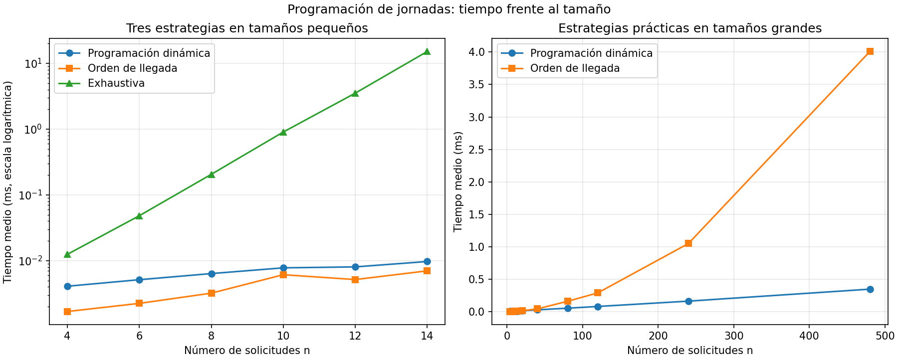
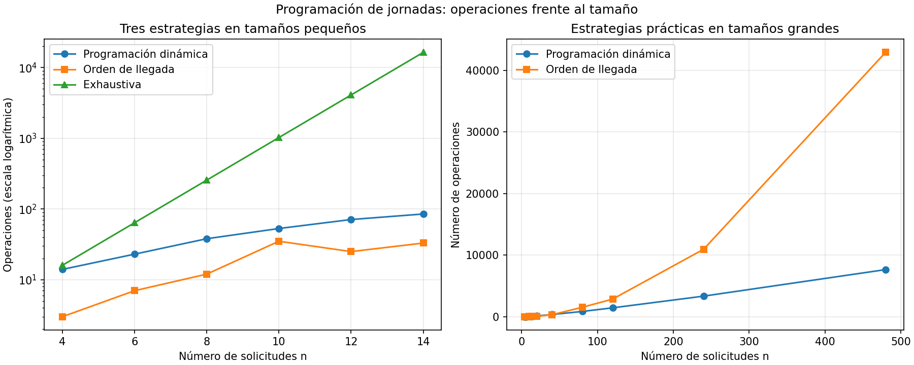

# Proyecto final — Análisis de algoritmos

**Caso 2: Plataforma Pulso**

**Integrantes:** Carla Giraldo, Sara Regino, Alejandra Madrid y Laura Posada.

## Análisis del problema

### Programación de las jornadas de las unidades móviles

Plataforma Pulso recibe mensualmente entre 40 y 120 solicitudes de jornada en
cada una de las nueve subregiones. Cada subregión dispone de una sola unidad
móvil. Una solicitud contiene la hora de inicio, la hora de finalización —que
ya incluye el desplazamiento— y el número de pacientes de alto riesgo
pendientes en el municipio.

La entrada de la operación es una lista de jornadas representadas por tuplas
`(inicio, fin, pacientes_alto_riesgo)`, con las horas expresadas en minutos. La
salida es un subconjunto de esas jornadas, ordenado por hora de inicio, cuya
suma de pacientes sea la mayor posible.

La solución debe cumplir las siguientes restricciones:

- una unidad móvil no puede estar asignada a dos jornadas que se crucen;
- dos jornadas que se tocan en un extremo son compatibles, pues se usa el
  intervalo `[inicio, fin)` y el desplazamiento ya está incluido en el fin;
- las solicitudes originales no se modifican;
- el resultado debe ser óptimo, no una aproximación;
- si existen varias programaciones con el mismo valor, cualquiera de ellas es
  válida siempre que cumpla las restricciones.

El criterio elegido es maximizar los pacientes de alto riesgo atendidos. No se
maximiza solamente la cantidad de jornadas, porque una jornada puede atender a
muchos más pacientes que otra.

### Supuestos de esta operación

- Cada subregión se procesa por separado porque dispone de una unidad móvil.
- La programación se calcula una vez al mes para cada una de las nueve
  subregiones.
- Dos jornadas que se tocan son compatibles: los intervalos son `[inicio, fin)`.
- El servidor consume 380 W durante la ejecución; se usa esa potencia constante
  como estimación conservadora.
- Los datos sintéticos conservan la estructura del caso, pero no representan
  una predicción de la demanda ni de los pacientes reales.

## Diseño de la solución

### Por qué el problema admite programación dinámica

Primero se ordenan las solicitudes por su hora de finalización. Para cada
jornada `j` se calcula `p(j)`: la cantidad de jornadas anteriores que terminan
antes o exactamente cuando empieza `j`. De esta manera, las jornadas
compatibles anteriores forman un prefijo de la lista ordenada.

Se define `M[j]` como el máximo número de pacientes que se puede atender usando
únicamente las primeras `j` jornadas. Para decidir sobre la jornada `j` se
comparan dos opciones:

1. No elegirla, por lo que se conserva `M[j - 1]`.
2. Elegirla, sumar sus pacientes `v[j]` y continuar con el mejor resultado del
   prefijo compatible `M[p(j)]`.

La recurrencia es:

```text
M[0] = 0
M[j] = max(M[j - 1], v[j] + M[p(j)])
```

El problema tiene **subestructura óptima**: si una solución óptima incluye la
jornada `j`, las jornadas anteriores seleccionadas deben formar una solución
óptima para el prefijo `p(j)`. Si no fuera así, se podría sustituir ese prefijo
por uno mejor y aumentar el total de pacientes, contradiciendo la optimalidad.

También existen **subproblemas traslapados**. Valores como `M[2]` o `M[3]`
pueden ser necesarios al evaluar distintas jornadas posteriores. La tabla
guarda cada resultado una sola vez y se llena de izquierda a derecha, ya que
`M[j]` depende únicamente de posiciones menores que `j`.

Ordenar y calcular `p(j)` mediante búsqueda binaria cuesta `Θ(n log n)`. Llenar
la tabla y reconstruir una solución cuesta `Θ(n)`. Por tanto, la complejidad
temporal total es `Θ(n log n)` y el espacio adicional es `Θ(n)`.

### Ejemplo resuelto a mano

Considérese una subregión con las siguientes seis solicitudes:

| Jornada | Horario | Pacientes |
|---|---|---:|
| A | 08:00–10:00 | 20 |
| B | 09:00–12:00 | 55 |
| C | 10:00–11:00 | 15 |
| D | 11:00–13:00 | 25 |
| E | 12:00–15:00 | 50 |
| F | 14:00–16:00 | 30 |

Al ordenar por hora de finalización se obtiene `A, C, B, D, E, F`. Los valores
de compatibilidad y de la tabla dinámica son:

| `j` | Jornada | `p(j)` | No elegir: `M[j-1]` | Elegir: `v[j] + M[p(j)]` | `M[j]` |
|---:|---|---:|---:|---:|---:|
| 0 | — | — | — | — | 0 |
| 1 | A | 0 | 0 | 20 + 0 = 20 | 20 |
| 2 | C | 1 | 20 | 15 + 20 = 35 | 35 |
| 3 | B | 0 | 35 | 55 + 0 = 55 | 55 |
| 4 | D | 2 | 55 | 25 + 35 = 60 | 60 |
| 5 | E | 3 | 60 | 50 + 55 = 105 | 105 |
| 6 | F | 4 | 105 | 30 + 60 = 90 | 105 |

La respuesta es `M[6] = 105`. Para reconstruirla se comienza en la última
posición. F no se elige porque 90 no supera 105. E sí se elige y se salta a
`p(5) = 3`. En esa posición se elige B y se llega al caso base. La programación
óptima es, por tanto, B de 09:00 a 12:00 y E de 12:00 a 15:00, que atienden
`55 + 50 = 105` pacientes sin cruces.

## Implementación

La solución se separó en módulos con responsabilidades específicas:

- [`estrategia.py`](src/jornadas_unidades/estrategia.py): ordenamiento,
  compatibilidades, tabla dinámica y reconstrucción de las jornadas.
- [`exhaustivo.py`](src/jornadas_unidades/exhaustivo.py): referencia exacta que
  enumera todos los subconjuntos para entradas pequeñas.
- [`regla_actual.py`](src/jornadas_unidades/regla_actual.py): asignación en el
  orden de llegada usada como línea base.
- [`datos.py`](src/jornadas_unidades/datos.py): solicitudes sintéticas con
  semilla fija.
- [`pruebas.py`](src/jornadas_unidades/pruebas.py): casos límite, ejemplo manual,
  contraejemplo y 50 instancias aleatorias.
- [`medicion.py`](src/jornadas_unidades/medicion.py): cronometraje, conteo de
  operaciones y generación de gráficas.

Las funciones trabajan con copias o listas nuevas para conservar las
solicitudes originales. La solución exhaustiva ordena una vez las solicitudes
y después recorre sus `2^n` subconjuntos; se usa como oráculo, no como propuesta
para producción.

## Evaluación del desempeño

### Complejidad y verificación

La programación dinámica tarda `Θ(n log n)`: el ordenamiento y las `n`
búsquedas binarias dominan el llenado y la reconstrucción lineales. Usa
`Θ(n)` de espacio para las listas ordenadas, las compatibilidades, la tabla y
la solución reconstruida.

La solución exhaustiva considera `2^n` subconjuntos y dedica hasta `Θ(n)` a
construir y revisar cada uno. Su tiempo es `Θ(n·2^n)` y su espacio auxiliar es
`Θ(n)`. La regla actual puede comparar cada nueva solicitud con todas las ya
aceptadas: tarda `O(n²)` en el peor caso y usa `O(n)` de espacio.

Para respaldar el análisis espacial se midió con `tracemalloc` la memoria
adicional máxima de la programación dinámica, después de generar la entrada y
de una ejecución inicial de calentamiento. Con 120 solicitudes el pico fue de
aproximadamente **5,6 KiB** y con 480 fue de **29,7 KiB**. Al multiplicar `n`
por cuatro, la memoria creció cerca de 5,3 veces, una variación compatible con
el crecimiento lineal y con la administración interna de memoria de Python.
La medición no incluye la lista de entrada, el intérprete ni sus bibliotecas;
representa solamente las asignaciones adicionales durante el algoritmo.

Las pruebas cubren la entrada vacía, una jornada, ninguna y todas las jornadas
cruzadas, jornadas que se tocan, el ejemplo manual y el contraejemplo de la
regla actual. También comparan el valor de la solución dinámica con el de la
exhaustiva en 50 instancias aleatorias pequeñas y verifican que no haya cruces.

### Metodología de medición

La comparación usa las mismas solicitudes para las tres estrategias en cada
tamaño. Las instancias se generan antes del cronómetro con la semilla
`2026 + n`; así, crear los datos no se atribuye a los algoritmos. Cada tiempo
es el promedio de cinco ejecuciones medido con `time.perf_counter()`.

La exhaustiva se ejecuta con 4, 6, 8, 10, 12 y 14 solicitudes. Las soluciones
prácticas también se miden con 20, 40, 80, 120, 240 y 480 solicitudes. El
experimento verifica que dinámica y exhaustiva produzcan el mismo valor óptimo.
Además se cuentan comparaciones, decisiones de la tabla y subconjuntos.

Los tiempos dependen del computador y de los procesos activos. Por eso se
interpretan junto con el conteo de operaciones, que permite comprobar la
tendencia con menor dependencia del equipo.

### Resultados y contraste con la teoría





La exhaustiva pasa de 16 subconjuntos con `n = 4` a 16 384 con `n = 14`; su
curva se separa rápidamente. Sirve para verificar entradas pequeñas, pero no
para las 40 a 120 solicitudes mensuales de una subregión.

La pareja común que duplica el tamaño es `n = 6` y `n = 12`. La dinámica pasó
de 23 a 71 operaciones (factor 3,09), la regla actual de 7 a 25 (factor 3,57)
y la exhaustiva de 64 a 4 096 subconjuntos (factor 64). El tiempo exhaustivo
pasó de 0,048 a 3,524 ms (factor 73,42). Su factor queda entre el conteo de
subconjuntos `2^n` y el costo total `n·2^n`, cuyo factor teórico es 128, porque
muchos subconjuntos con cruces se descartan antes de recorrerlos completos.
Los tiempos diminutos de las otras dos estrategias presentan mayor ruido, por
lo que también se analiza una duplicación con entradas grandes.

| `n` | Operaciones: dinámica | Operaciones: regla actual |
|---:|---:|---:|
| 40 | 359 | 327 |
| 80 | 858 | 1 536 |
| 120 | 1 446 | 2 863 |
| 240 | 3 344 | 10 954 |
| 480 | 7 649 | 42 917 |

Al duplicar de 240 a 480 solicitudes, las operaciones de la programación
dinámica se multiplicaron por `7 649 / 3 344 = 2,29` y su tiempo por cerca de
`0,346 / 0,161 = 2,15`. El factor teórico para `n log n` es aproximadamente
`2·log(480)/log(240) = 2,25`; los resultados son coherentes con esa tendencia.

En la regla actual, las operaciones se multiplicaron por 3,92 y el tiempo por
3,82. Ambos valores se aproximan al factor 4 de un crecimiento cuadrático. Las
diferencias restantes son normales por la distribución de cruces, las salidas
anticipadas y el ruido de medir fracciones de milisegundo.

La calidad del resultado también importa. En los datos sintéticos, la regla
actual dejó pacientes sin atender frente al óptimo:

| `n` | Pacientes: dinámica | Pacientes: regla actual | Diferencia |
|---:|---:|---:|---:|
| 40 | 2 201 | 1 736 | 465 |
| 80 | 4 116 | 3 902 | 214 |
| 120 | 5 171 | 3 778 | 1 393 |
| 480 | 21 933 | 16 576 | 5 357 |

Estas cifras no predicen la demanda real. Demuestran que aceptar por llegada
no garantiza el óptimo y que el resultado depende del orden de recepción.

### Escala real y ventana de referencia

El caso no fija una ventana para programar las jornadas. Se adopta como
referencia conservadora **un minuto para procesar las nueve subregiones**, pues
la planeación mensual debe responder de manera inmediata al coordinador. En la
ejecución usada para las gráficas se obtuvieron estos valores:

| `n` por subregión | Dinámica: 1 región | Regla actual: 1 región | Dinámica: 9 regiones |
|---:|---:|---:|---:|
| 40 | 0,028 ms | 0,042 ms | 0,252 ms |
| 120 | 0,079 ms | 0,288 ms | 0,711 ms |

Las dos soluciones prácticas caben en la referencia, pero solo la dinámica
garantiza el máximo de pacientes. Para la exhaustiva se tomó la medición de
15,1 ms con `n = 14` y se aplicó su crecimiento `n·2^n`. La estimación es de
unos 34 días por subregión con `n = 40` y `3,3·10^23` años con `n = 120`; por
tanto, no terminaría en una ventana útil. Son extrapolaciones, no ejecuciones
del volumen real.

## Análisis comparativo

### Contraejemplo de la asignación por orden de llegada

La Secretaría acepta las solicitudes en el orden en que llegan y rechaza las
que se crucen con una ya aceptada:

| Orden | Jornada | Inicio | Fin | Pacientes |
|---:|---|---:|---:|---:|
| 1 | A | 08:00 | 16:00 | 30 |
| 2 | B | 08:00 | 12:00 | 40 |
| 3 | C | 12:00 | 16:00 | 45 |

La regla acepta A y rechaza B y C, por lo que atiende 30 pacientes. La solución
óptima selecciona B y C, que son compatibles porque C empieza cuando B termina,
y atiende `40 + 45 = 85`. La regla actual deja de atender a **55 pacientes**.

### Condición que permitiría una estrategia voraz

Si el objetivo cambiara a maximizar solamente el **número de jornadas**, o si
todas tuvieran el mismo peso, sería correcta la selección de actividades:
ordenar por finalización y elegir siempre la siguiente jornada compatible que
termine primero. Esto no vuelve óptimo el orden de llegada, porque la estrategia
voraz correcta necesita ordenar previamente.

### Recomendación para la operación

Se recomienda la programación dinámica de intervalos ponderados. Garantiza el
máximo de pacientes sin cruces, conserva las entradas y escala como
`Θ(n log n)`. La exhaustiva debe limitarse a pruebas pequeñas y la regla actual
puede conservarse como línea base, pero no debe decidir la programación.

El principal riesgo es la calidad de los datos: horarios o cantidades de
pacientes incorrectos producen una programación óptima para una entrada
equivocada. La organización debe validar las solicitudes y conservar su
trazabilidad. Si el volumen crece, la solución dinámica mantiene una tendencia
muy inferior al crecimiento cuadrático observado en la regla actual.

## Implicaciones éticas, sociales y ambientales

### Consumo energético

Se estima la energía con `E = P·t`, donde `P = 380 W = 0,38 kW` y el tiempo se
convierte de segundos a horas. La proyección anual considera nueve subregiones,
una ejecución mensual por subregión y doce meses.

| `n` | Energía anual: dinámica | Energía anual: regla actual | Ahorro anual estimado |
|---:|---:|---:|---:|
| 40 | `3,19·10^-7` kWh | `4,79·10^-7` kWh | `1,60·10^-7` kWh |
| 120 | `9,01·10^-7` kWh | `3,28·10^-6` kWh | `2,38·10^-6` kWh |

El ahorro absoluto es muy pequeño porque esta operación dura milisegundos y se
ejecuta solo una vez al mes. No sería responsable afirmar un gran beneficio
ambiental con estas cifras. La ventaja principal es social y operativa: atender
el máximo de pacientes de alto riesgo con un costo computacional bajo.

La estimación supone 380 W constantes durante el algoritmo y no incluye el
consumo en reposo, refrigeración, almacenamiento ni otros procesos del servidor.
La exhaustiva, en cambio, requeriría cerca de 306 kWh para una sola subregión de
40 solicitudes y sería físicamente inviable con 120. Evitarla sí previene un
desperdicio energético considerable.

Las demás implicaciones éticas, sociales, normativas y ambientales del proceso
completo quedan pendientes para la entrega final del proyecto.

## Conclusiones

La programación dinámica coincide con la solución exacta en las pruebas y
supera la regla actual en pacientes atendidos. Las mediciones reproducen el
crecimiento `Θ(n log n)` y muestran que el volumen real cabe ampliamente en la
referencia operativa. La solución exhaustiva es útil para verificar, no para
producción. Las conclusiones del proceso completo se completarán con la segunda
operación en la entrega final.

## Reproducción de pruebas y mediciones

Desde la raíz del repositorio, cree y active el entorno virtual:

```bash
python3 -m venv .venv
source .venv/bin/activate
python -m pip install -r requirements.txt
```

Ejecute las pruebas y luego regenere las mediciones y gráficas:

```bash
python src/jornadas_unidades/pruebas.py
python src/jornadas_unidades/medicion.py
```

La medición usa semillas y tamaños fijos. Los tiempos pueden variar entre
equipos, pero las instancias, los conteos y las tendencias son reproducibles.

